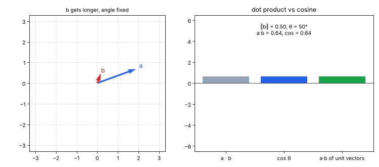
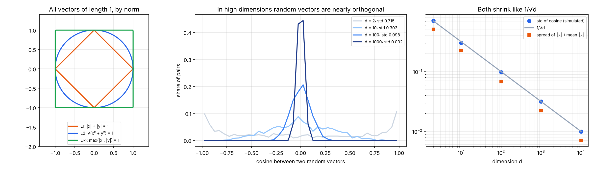
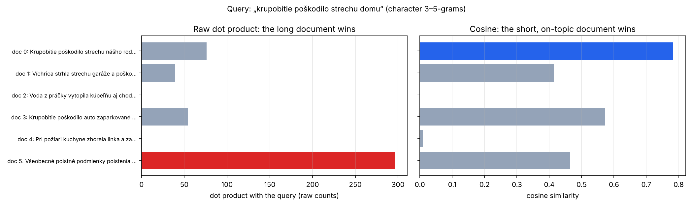
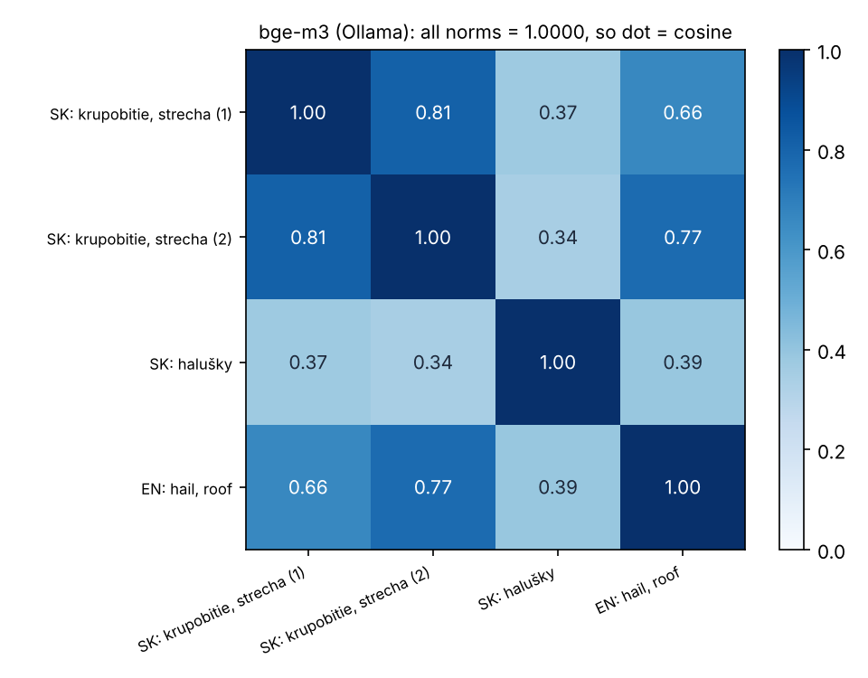

# 10 · Norms, cosine similarity & when cosine = dot product

🇸🇰 [Slovenská verzia](README.sk.md)

## TL;DR
The math minimum before P6 (embeddings and retrieval). Goal from the roadmap: *explain when cosine = dot product*. The short answer is **when both vectors have length 1.** Four experiments (seed 0, every number from `results.json` / `results_bge_m3.json`):
- **The identity:** a·b = ‖a‖‖b‖ cos θ, checked on 200 × 1000 random 384-d vectors to 6.8e-13.
  - After L2-normalisation, dot product = cosine (difference 0.0), and ‖a − b‖² = 2 − 2 cos θ (to 1.3e-15).
  - So dot, cosine and Euclidean distance return **identical top-10 neighbours for 100 % of queries**.
  - On the *raw* (unnormalised) vectors, the dot-product top 10 matches the cosine top 10 for **0 %** of queries (39 % overlap). It prefers long vectors: their mean norm is 84.9, vs 50.4 for all documents.
- **High dimensions:** two random vectors in d = 1000 have |cos| < 0.1 in 99.9 % of pairs (std 0.0317 vs theory 1/√d = 0.0316), and their lengths vary by only 2.2 %.
- **Retrieval on Slovak text** (character n-grams): for the query „krupobitie poškodilo strechu domu“, the raw dot product puts a long, generic policy text first (296 vs 76). Cosine puts the short on-topic claim first (0.78 vs 0.46).
- **Real embeddings:** bge-m3 from Ollama on the Mac returns 1024-d vectors with norm **1.0000**, so for it dot = cosine. Two Slovak hail claims score 0.81, the English hail claim 0.66–0.77, a halušky recipe 0.34–0.39.



## Problem
Retrieval (P6, P7) ranks documents by how "close" their embedding is to the query's. Vector databases offer three metrics: dot product (inner product), cosine similarity and Euclidean (L2) distance. Which one to use, and when does it not matter? Three ideas are needed:
1. a **norm** = the length of a vector, and there are several ways to measure it;
2. the **dot product** mixes two things, length and angle; **cosine** keeps only the angle;
3. high-dimensional spaces behave in surprising ways (lengths concentrate, random directions are nearly orthogonal).

Source: Mathematics for Machine Learning, ch. 3 (analytic geometry).

## How it works

### 1. Norms (`norms`)
For v = [3, −4]:
- L1 = |3| + |−4| = **7** ("taxi distance");
- L2 = √(9 + 16) = **5** (straight-line length);
- L∞ = max = **4**.

The set of vectors with norm 1 is a diamond (L1), a circle (L2) or a square (L∞) (left plot). Embeddings almost always use L2.

### 2. High dimensions (`high_dim`)
2000 Gaussian random vectors per dimension:

| d | ‖x‖ / √d | spread of ‖x‖ (std / mean) | std of cos between random pairs | 1/√d | pairs with \|cos\| < 0.1 |
|---|---|---|---|---|---|
| 2 | 0.889 | 0.512 | 0.715 | 0.707 | 6.1 % |
| 10 | 0.971 | 0.226 | 0.303 | 0.316 | 28.2 % |
| 100 | 1.000 | 0.068 | 0.098 | 0.100 | 68.5 % |
| 1000 | 0.999 | 0.022 | 0.032 | 0.032 | 99.9 % |
| 10000 | 1.000 | 0.007 | 0.010 | 0.010 | 100.0 % |

- **Unrelated means cos ≈ 0.** In 1024-d embedding space, "unrelated" texts land near cos 0, so a cosine of 0.3 already carries signal.
- **Lengths of random vectors are almost all the same** (√d). Big differences in length between real embeddings therefore come from the model, not from chance, and the dot product would let them dominate the ranking.



### 3. When cosine = dot product (`identities`)
```
a · b = ‖a‖ ‖b‖ cos θ             →   cos θ = a·b / (‖a‖ ‖b‖)
if ‖a‖ = ‖b‖ = 1:   a · b = cos θ        and   ‖a − b‖² = ‖a‖² + ‖b‖² − 2 a·b = 2 − 2 cos θ
```
So on unit vectors all three metrics are one number in disguise: the biggest dot = the biggest cosine = the smallest distance.

The code checks this with 1000 "document" vectors (384-d, lengths deliberately random between 4.2 and 103) and 200 queries:

| Check | Result |
|---|---|
| max \|a·b − ‖a‖‖b‖ cos θ\| | 6.8e-13 |
| max \|dot of normalised vectors − cos\| | 0.0 |
| max \|‖a − b‖² − (2 − 2 cos θ)\| on normalised vectors | 1.3e-15 |
| identical top-10: cosine vs normalised dot / normalised L2 | 100 % / 100 % |
| identical top-10: cosine vs **raw** dot | **0 %** (mean overlap 39 %) |
| mean norm of raw-dot top-10 documents vs all documents | 84.9 vs 50.4 |

On unnormalised vectors the dot product rewards *length*, not just direction.

### 4. Retrieval on Slovak text (`retrieval`)
- Five short documents (insurance claims) plus one long, generic policy text that repeats words like *poškodenie*, *strecha*, *dom*.
- Vectors are counts of character 3–5-grams. That way *strechu / strechy / strecha* still share pieces despite Slovak inflection.
- Query: „krupobitie poškodilo strechu domu“.

| Document | ‖d‖ | dot | cosine |
|---|---|---|---|
| 0 · Krupobitie poškodilo strechu nášho rodinného domu. | 11.0 | 76 | **0.782** |
| 3 · Krupobitie poškodilo auto zaparkované pred domom. | 10.7 | 54 | 0.573 |
| 5 · Všeobecné poistné podmienky … (424 characters) | 72.2 | **296** | 0.464 |
| 1 · Víchrica strhla strechu garáže a poškodila plot. | 10.7 | 39 | 0.414 |
| 4 · Pri požiari kuchyne … | 11.2 | 1 | 0.010 |
| 2 · Voda z práčky vytopila kúpeľňu … | 9.2 | 0 | 0.000 |

The long text wins the dot product simply because it has more of everything (norm 72 vs ~11). Cosine divides that out and ranks the actual hail-on-a-roof claim first. That is also why TF-IDF (`TfidfVectorizer`) L2-normalises by default, and why BM25 has a document-length penalty (P7).



### 5. Real embeddings: bge-m3 (`bge_m3_check.py`, run on the Mac)
One request to the local Ollama for four texts: 1024-dimensional vectors, **every norm = 1.0000**. bge-m3 normalises its output, so dot product, cosine and L2 all give the same ranking, and the fast inner-product index can be used.



- The two Slovak hail claims: **0.81**.
- The English hail claim vs the Slovak ones: 0.66 and 0.77. The model is multilingual, so the same meaning across languages ends up close.
- The halušky recipe vs everything: 0.34–0.39. Note that "unrelated" here is not 0, unlike for random vectors. Real embeddings share a common direction, so judge scores relative to each other, never by an absolute cut-off picked by feel.

## Results
| Question | Answer (number) |
|---|---|
| When is cosine = dot product? | when both vectors have L2 norm 1 (difference 0.0) |
| Do dot / cosine / L2 agree on unit vectors? | yes, identical top-10 for 100 % of 200 queries |
| …and on raw vectors? | no, 0 % identical top-10, raw dot prefers long vectors (norm 84.9 vs 50.4) |
| Random pairs in d = 1000 with \|cos\| < 0.1 | 99.9 % |
| Slovak retrieval, top-1 by dot / by cosine | long generic text (296) / on-topic claim (0.782) |
| bge-m3 vector norm (Ollama, Mac) | 1.0000 for all 4 texts |
| bge-m3 cosine: SK–SK hail / SK–EN hail / hail–recipe | 0.81 / 0.66–0.77 / 0.34–0.39 |

## Visual example: why not the cars
The cars' sensors are vectors too, but the question here (which document is closest to a query) belongs to text. The visuals are the GIF at the top and the bge-m3 heatmap. In the GIF, making b longer pushes the dot product up while the cosine stays still, and turning b moves both.

## What I learned
- Cosine = dot product / (‖a‖‖b‖); on unit vectors the denominator is 1, so they are the same, and L2 distance gives the same ranking too.
- Without normalisation the dot product mixes "how similar" with "how long". Long documents and frequent tokens win for the wrong reason.
- Check whether your embedding model already normalises (bge-m3: yes). If it does, use the cheaper inner-product index. If not, normalise once at indexing time.
- In high dimensions random vectors are nearly orthogonal, so moderate cosines carry signal. Real embeddings are not random, though: unrelated texts still score about 0.35 with bge-m3.

## Run it
```bash
uv sync
uv run python cosine.py        # experiments → results.json
uv run python bge_m3_check.py  # needs local Ollama + `ollama pull bge-m3` → results_bge_m3.json
uv run python plot.py          # assets/norms_high_dim.png, retrieval.png, bge_m3.png, cosine_vs_dot.gif
```

## Limitations
- The retrieval corpus is 6 hand-written documents, built to show the length effect clearly. It is a demonstration, not a benchmark (that is P6's golden set).
- The bge-m3 check was run once on the Mac (Ollama 0.33.0) with 4 texts. `results_bge_m3.json` stores that run; the cloud machine that made the other numbers has no Ollama.
- The high-dimensional experiment uses Gaussian vectors; real embeddings are not isotropic (see the 0.35 floor above).
