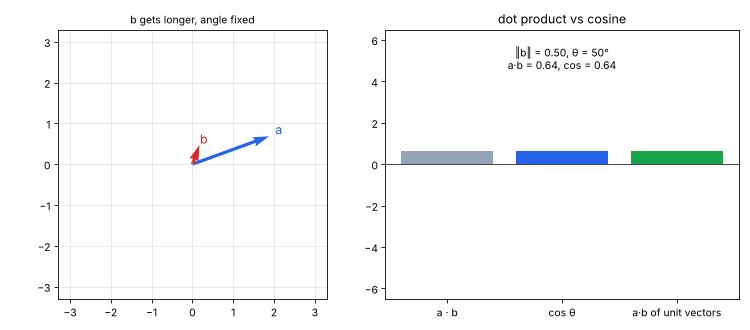
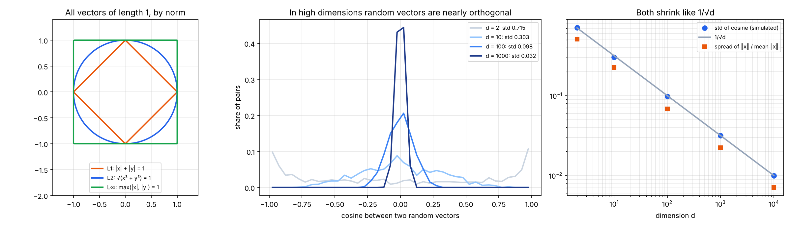
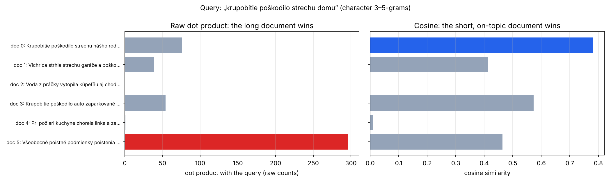
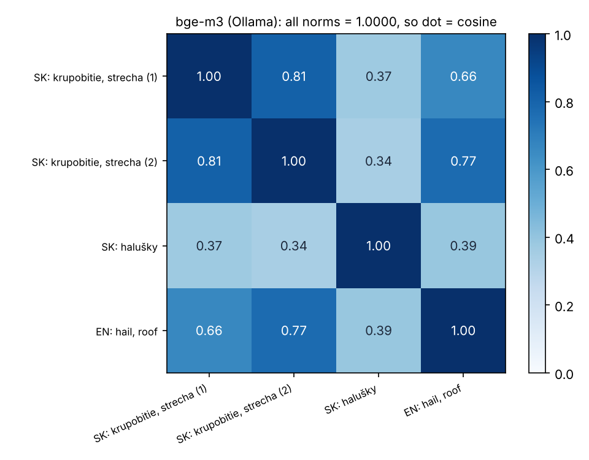

# 10 · Normy, cosine similarity a kedy cosine = skalárny súčin

🇬🇧 [English version](README.md)

## TL;DR
Matematické minimum pred P6 (embeddingy a retrieval). Cieľ podľa roadmapy: *vysvetliť, kedy cosine = skalárny súčin (dot product)*. Krátka odpoveď je **keď majú oba vektory dĺžku 1.** Štyri experimenty (seed 0, každé číslo z `results.json` / `results_bge_m3.json`):
- **Identita:** a·b = ‖a‖‖b‖ cos θ, overená na 200 × 1000 náhodných 384-rozmerných vektoroch na 6,8e-13.
  - Po L2 normalizácii platí skalárny súčin = cosine (rozdiel 0,0) a ‖a − b‖² = 2 − 2 cos θ (na 1,3e-15).
  - Skalárny súčin, cosine aj euklidovská vzdialenosť teda vrátia **rovnakých 10 najbližších susedov pri 100 % dopytov**.
  - Na *surových* (nenormalizovaných) vektoroch sa top 10 podľa skalárneho súčinu zhoduje s top 10 podľa cosine pri **0 %** dopytov (prienik 39 %). Uprednostňuje dlhé vektory: ich priemerná norma je 84,9 oproti 50,4 pre všetky dokumenty.
- **Vysoké dimenzie:** dva náhodné vektory v d = 1000 majú |cos| < 0,1 v 99,9 % párov (smer. odchýlka 0,0317 vs teória 1/√d = 0,0316) a ich dĺžky sa líšia len o 2,2 %.
- **Retrieval na slovenskom texte** (znakové n-gramy): pre dopyt „krupobitie poškodilo strechu domu“ dá surový skalárny súčin na prvé miesto dlhý všeobecný text poistných podmienok (296 vs 76). Cosine dá na prvé miesto krátke hlásenie k téme (0,78 vs 0,46).
- **Skutočné embeddingy:** bge-m3 z Ollamy na Macu vracia 1024-rozmerné vektory s normou **1,0000**, takže preň platí skalárny súčin = cosine. Dve slovenské hlásenia o krupobití majú 0,81, anglické hlásenie o krupobití 0,66–0,77 a recept na halušky 0,34–0,39.



## Najprv jednoducho
Predstav si vyhľadávanie: napíšeš „krupobitie poškodilo strechu domu“ a chceš nájsť podobné hlásenie. Texty sa najprv zmenia na zoznamy čísel, nazývané **embeddingy**. Potom treba rozhodnúť, ktoré zoznamy sú si najbližšie. Táto úloha skúma, prečo rôzne spôsoby porovnávania niekedy vrátia iný výsledok.

**Norma** je dĺžka zoznamu čísel v geometrickom zmysle. Surový skalárny súčin odmeňuje aj podobný smer, aj veľkú dĺžku. Preto môže dlhý všeobecný dokument poraziť krátke presné hlásenie. **Kosínusová podobnosť** porovnáva iba smer a v tomto príklade dá na prvé miesto tematicky správne hlásenie. Ak oba vektory najprv normalizujeme na dĺžku 1, kosínusová podobnosť a skalárny súčin sú rovnaké číslo.

Skript to overí na umelých vektoroch, ukáže rozdiel v slovenskom vyhľadávaní a skontroluje skutočné embeddingy modelu bge-m3. GIF znázorňuje, ako dlhý vektor vie ovplyvniť poradie. Praktické ponaučenie: pred výberom metriky treba vedieť, či sú embeddingy normalizované.

## Problém
Retrieval (P6, P7) zoraďuje dokumenty podľa toho, ako „blízko“ je ich embedding k embeddingu dopytu. Vektorové databázy ponúkajú tri metriky: skalárny súčin (inner product), cosine similarity a euklidovskú (L2) vzdialenosť. Ktorú použiť a kedy je to jedno? Treba tri myšlienky:
1. **norma** = dĺžka vektora, a dá sa merať viacerými spôsobmi;
2. **skalárny súčin** mieša dve veci, dĺžku a uhol; **cosine** si nechá len uhol;
3. vysokorozmerné priestory sa správajú prekvapivo (dĺžky sa koncentrujú, náhodné smery sú takmer kolmé).

Zdroj: Mathematics for Machine Learning, kap. 3 (analytická geometria).

## Ako to funguje

### 1. Normy (`norms`)
Pre v = [3, −4]:
- L1 = |3| + |−4| = **7** („taxíková vzdialenosť“);
- L2 = √(9 + 16) = **5** (dĺžka vzdušnou čiarou);
- L∞ = maximum = **4**.

Množina vektorov s normou 1 je kosoštvorec (L1), kružnica (L2) alebo štvorec (L∞) (ľavý graf). Embeddingy takmer vždy používajú L2.

### 2. Vysoké dimenzie (`high_dim`)
2000 náhodných gaussovských vektorov pre každú dimenziu:

| d | ‖x‖ / √d | rozptyl ‖x‖ (std / priemer) | std cos medzi náhodnými pármi | 1/√d | páry s \|cos\| < 0,1 |
|---|---|---|---|---|---|
| 2 | 0,889 | 0,512 | 0,715 | 0,707 | 6,1 % |
| 10 | 0,971 | 0,226 | 0,303 | 0,316 | 28,2 % |
| 100 | 1,000 | 0,068 | 0,098 | 0,100 | 68,5 % |
| 1000 | 0,999 | 0,022 | 0,032 | 0,032 | 99,9 % |
| 10000 | 1,000 | 0,007 | 0,010 | 0,010 | 100,0 % |

- **Nesúvisiace znamená cos ≈ 0.** V 1024-rozmernom priestore embeddingov padnú „nesúvisiace“ texty blízko cos 0, takže aj cosine 0,3 už nesie signál.
- **Dĺžky náhodných vektorov sú takmer rovnaké** (√d). Veľké rozdiely v dĺžke medzi skutočnými embeddingmi preto pochádzajú z modelu, nie z náhody, a skalárny súčin by im dovolil ovládnuť poradie.



### 3. Kedy cosine = skalárny súčin (`identities`)
```
a · b = ‖a‖ ‖b‖ cos θ             →   cos θ = a·b / (‖a‖ ‖b‖)
ak ‖a‖ = ‖b‖ = 1:   a · b = cos θ        a   ‖a − b‖² = ‖a‖² + ‖b‖² − 2 a·b = 2 − 2 cos θ
```
Na jednotkových vektoroch sú teda všetky tri metriky jedno číslo v prestrojení: najväčší skalárny súčin = najväčší cosine = najmenšia vzdialenosť.

Kód to overí na 1000 „dokumentových“ vektoroch (384 rozmerov, dĺžky zámerne náhodné medzi 4,2 a 103) a 200 dopytoch:

| Kontrola | Výsledok |
|---|---|
| max \|a·b − ‖a‖‖b‖ cos θ\| | 6,8e-13 |
| max \|skalárny súčin normalizovaných vektorov − cos\| | 0,0 |
| max \|‖a − b‖² − (2 − 2 cos θ)\| na normalizovaných vektoroch | 1,3e-15 |
| rovnakých top-10: cosine vs normalizovaný súčin / normalizovaná L2 | 100 % / 100 % |
| rovnakých top-10: cosine vs **surový** súčin | **0 %** (priemerný prienik 39 %) |
| priemerná norma top-10 dokumentov podľa surového súčinu vs všetky dokumenty | 84,9 vs 50,4 |

Na nenormalizovaných vektoroch skalárny súčin odmeňuje *dĺžku*, nielen smer.

### 4. Retrieval na slovenskom texte (`retrieval`)
- Päť krátkych dokumentov (poistné hlásenia) plus jeden dlhý všeobecný text poistných podmienok, ktorý opakuje slová ako *poškodenie*, *strecha*, *dom*.
- Vektory sú počty znakových 3–5-gramov. Vďaka tomu majú *strechu / strechy / strecha* napriek slovenskému skloňovaniu spoločné kúsky.
- Dopyt: „krupobitie poškodilo strechu domu“.

| Dokument | ‖d‖ | súčin | cosine |
|---|---|---|---|
| 0 · Krupobitie poškodilo strechu nášho rodinného domu. | 11,0 | 76 | **0,782** |
| 3 · Krupobitie poškodilo auto zaparkované pred domom. | 10,7 | 54 | 0,573 |
| 5 · Všeobecné poistné podmienky … (424 znakov) | 72,2 | **296** | 0,464 |
| 1 · Víchrica strhla strechu garáže a poškodila plot. | 10,7 | 39 | 0,414 |
| 4 · Pri požiari kuchyne … | 11,2 | 1 | 0,010 |
| 2 · Voda z práčky vytopila kúpeľňu … | 9,2 | 0 | 0,000 |

Dlhý text vyhrá skalárny súčin len preto, že má viac všetkého (norma 72 oproti ~11). Cosine to vydelí a na prvé miesto dá naozajstné hlásenie o krupobití na streche. Preto aj TF-IDF (`TfidfVectorizer`) štandardne normalizuje cez L2 a BM25 má penalizáciu za dĺžku dokumentu (P7).



### 5. Skutočné embeddingy: bge-m3 (`bge_m3_check.py`, spustené na Macu)
Jedna požiadavka na lokálnu Ollamu pre štyri texty: 1024-rozmerné vektory, **každá norma = 1,0000**. bge-m3 svoj výstup normalizuje, takže skalárny súčin, cosine aj L2 dajú rovnaké poradie a dá sa použiť rýchly index na skalárny súčin.



- Dve slovenské hlásenia o krupobití: **0,81**.
- Anglické hlásenie o krupobití vs slovenské: 0,66 a 0,77. Model je viacjazyčný, takže rovnaký význam v rôznych jazykoch skončí blízko.
- Recept na halušky vs všetko ostatné: 0,34–0,39. Všimni si, že „nesúvisiace“ tu nie je 0, na rozdiel od náhodných vektorov. Skutočné embeddingy majú spoločný smer, takže skóre posudzuj navzájom relatívne, nikdy podľa absolútneho prahu zvoleného od oka.

## Výsledky
| Otázka | Odpoveď (číslo) |
|---|---|
| Kedy je cosine = skalárny súčin? | keď majú oba vektory L2 normu 1 (rozdiel 0,0) |
| Zhodnú sa súčin / cosine / L2 na jednotkových vektoroch? | áno, rovnakých top-10 pri 100 % z 200 dopytov |
| …a na surových vektoroch? | nie, 0 % rovnakých top-10, surový súčin uprednostňuje dlhé vektory (norma 84,9 vs 50,4) |
| Náhodné páry v d = 1000 s \|cos\| < 0,1 | 99,9 % |
| Slovenský retrieval, top-1 podľa súčinu / podľa cosine | dlhý všeobecný text (296) / hlásenie k téme (0,782) |
| Norma vektora bge-m3 (Ollama, Mac) | 1,0000 pre všetky 4 texty |
| cosine bge-m3: SK–SK krupobitie / SK–EN krupobitie / krupobitie–recept | 0,81 / 0,66–0,77 / 0,34–0,39 |

## Vizuálny príklad: prečo nie autíčka
Aj senzory autíčok sú vektory, ale otázka tu (ktorý dokument je najbližšie k dopytu) patrí k textu. Vizuálmi sú GIF hore a heatmapa bge-m3. V GIFe predĺženie b zvyšuje skalárny súčin, kým cosine stojí, a otáčanie b hýbe oboma.

## Čo som sa naučil
- Cosine = skalárny súčin / (‖a‖‖b‖); na jednotkových vektoroch je menovateľ 1, takže sú rovnaké, a rovnaké poradie dá aj L2 vzdialenosť.
- Bez normalizácie skalárny súčin mieša „ako podobné“ s „ako dlhé“. Dlhé dokumenty a časté tokeny vyhrávajú zo zlého dôvodu.
- Over, či tvoj embedding model už normalizuje (bge-m3: áno). Ak áno, použi lacnejší index na skalárny súčin. Ak nie, normalizuj raz pri indexovaní.
- Vo vysokých dimenziách sú náhodné vektory takmer kolmé, takže aj stredne veľké cosine nesú signál. Skutočné embeddingy však nie sú náhodné: nesúvisiace texty majú s bge-m3 stále okolo 0,35.

## Spustenie
```bash
uv sync
uv run python cosine.py        # experimenty → results.json
uv run python bge_m3_check.py  # potrebuje lokálnu Ollamu + `ollama pull bge-m3` → results_bge_m3.json
uv run python plot.py          # assets/norms_high_dim.png, retrieval.png, bge_m3.png, cosine_vs_dot.gif
```

## Obmedzenia
- Korpus na retrieval je 6 ručne napísaných dokumentov, zostavených tak, aby jasne ukázali efekt dĺžky. Je to ukážka, nie benchmark (to je golden set v P6).
- Kontrola bge-m3 bežala raz na Macu (Ollama 0.33.0) so 4 textami. `results_bge_m3.json` uchováva ten beh; cloudový stroj, ktorý vyrobil ostatné čísla, Ollamu nemá.
- Experiment s vysokými dimenziami používa gaussovské vektory; skutočné embeddingy nie sú izotropné (pozri spomínané dno 0,35).
